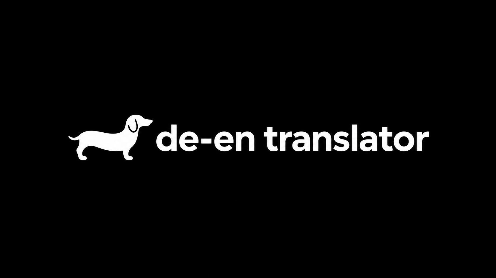

# German → English Translator



A PyTorch implementation of an encoder–decoder Transformer for German-to-English translation, based on *Attention Is All You Need*. The repository includes data preparation, SentencePiece tokenization, training, evaluation, and inference profiling for IWSLT17 and WMT14 models. Read the blog for details on the experiments and inference optimizations.

**[Blog](https://medium.com/@maminsed/building-a-german-to-english-transformer-in-pytorch-experiments-and-inference-optimizations-8840a53fd706)** · **[Hugging Face model](https://huggingface.co/maminsed/de-en-translator)** · **[Demo](https://huggingface.co/spaces/maminsed/de-en-translator-space)**

## Models

| Specification | IWSLT17 | WMT14 |
| --- | --- | --- |
| Translation direction | German → English | German → English |
| Parameters | 47,686,656 | 63,046,656 |
| Encoder / decoder layers | 6 / 6 | 6 / 6 |
| Model dimension | 512 | 512 |
| Attention heads | 8 | 8 |
| Key / value dimension per head | 64 / 64 | 64 / 64 |
| Feed-forward dimension | 2,048 | 2,048 |
| Vocabulary size | 7,000 | 37,000 |
| Context length | 128 tokens | 128 tokens |
| Tokenizer | SentencePiece BPE | SentencePiece BPE |
| Normalization | Pre-LayerNorm | Pre-LayerNorm |
| Activation | ReLU | ReLU |
| Dropout (embeddings / sublayers) | 0.3 / 0.3 | 0.1 / 0.1 |
| Source / target word dropout | 0.1 / 0.1 | 0.0 / 0.0 |


Both models use sinusoidal positional encodings. Autoregressive decoding supports key/value caching and seperate prefill and decode with prefill caching. 

## Training configuration

| Setting | IWSLT17 | WMT14 |
| --- | --- | --- |
| Configured epochs | 45 | 30 |
| Training / validation batch size | 128 / 64 | 128 / 64 |
| Optimizer | Adam | Adam |
| Adam β₁ / β₂ | 0.9 / 0.98 | 0.9 / 0.98 |
| Adam ε | 1e-9 | 1e-9 |
| Warmup steps | 3,000 | 3,000 |
| Peak learning rate | ≈ 8.07e-4 | ≈ 8.07e-4 |
| Label smoothing | 0.1 | 0.1 |
| Mixed precision | bfloat16 autocast | bfloat16 autocast |
| Seed in saved configuration | 42 | 123 |

These are configuration values, not evaluation results.

## Repository guide

| Path | Purpose |
| --- | --- |
| [train.py](train.py) | Transformer implementation, data loading, training, checkpointing, and validation |
| [data.ipynb](data.ipynb) | Dataset preparation and curation |
| [scripts/tokenizer.py](scripts/tokenizer.py) | SentencePiece BPE tokenizer training |
| [evaluation.ipynb](evaluation.ipynb) | Decoding, translation examples, and evaluation |
| [scripts/profiler.py](scripts/profiler.py) | Inference profiling |
| [artifacts/](artifacts/) | Experiment PNGs, comparison CSV, and validation metrics in `experiment_metrics.json` |
| [artifacts/profiler_trace/](artifacts/profiler_trace/) | Profiler configurations, timing summaries, Chrome traces, and console logs |
| [hf/](hf/) | Model configurations and Hugging Face packaging directory |
| [requirements.txt](requirements.txt) | Pinned dependencies |

## Running locally

Run these commands from the repository root. Utility scripts support both `python scripts/<name>.py` and `python -m scripts.<name>`.


```bash
python -m venv .venv
source .venv/bin/activate
python -m pip install -r requirements.txt
```

1. Prepare the data using `data.ipynb`. Training reads `train_df.csv` and `val_df.csv` from `data/<data_source>/`, with `detext` and `entext` columns.
2. Configure `scripts/tokenizer.py` and `train.py` for the same dataset and vocabulary size. Run `python scripts/tokenizer.py` to create `tokenizers/<tokenizer_source>/bpe.model`.
3. Set the run directory and configuration at the top of `train.py`. For a fresh run, set `LOAD_PRE_SAVED = False`; the current default resumes a checkpoint and requires its model, optimizer, scheduler, and configuration files. Ensure the run directory's parent directories exist.
4. Run `python train.py`. Use `evaluation.ipynb` for evaluation after setting its checkpoint and tokenizer paths.


## Links

- **Blog:** [Building a German-to-English Transformer in PyTorch: Experiments and Inference Optimizations](https://medium.com/@maminsed/building-a-german-to-english-transformer-in-pytorch-experiments-and-inference-optimizations-8840a53fd706)
- **Model:** [Hugging Face model](https://huggingface.co/maminsed/de-en-translator)
- **Demo:** [Hugging Face demo](https://huggingface.co/spaces/maminsed/de-en-translator-space)
