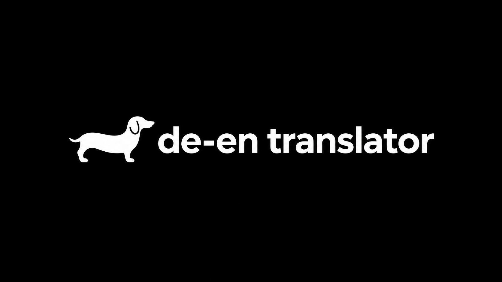

# German → English Transformer

A PyTorch encoder–decoder Transformer based on *Attention Is All You Need*.

**[Blog](https://medium.com/@maminsed/building-a-german-to-english-transformer-in-pytorch-experiments-and-inference-optimizations-8840a53fd706)** · **[Project repository](https://github.com/maminsed/Attention-is-All-You-Need)** · **[Demo](https://huggingface.co/spaces/maminsed/de-en-translator-space)**

Read [Building a German-to-English Transformer in PyTorch: Experiments and Inference Optimizations](https://medium.com/@maminsed/building-a-german-to-english-transformer-in-pytorch-experiments-and-inference-optimizations-8840a53fd706) for the experiments and inference optimizations.

## Training and evaluation

Both models translate German into English. The WMT14 model was trained on the German–English training split of WMT14, and the IWSLT17 model was trained on the corresponding IWSLT17 training split. Each model used its dataset's validation split for validation.

## How to use

1. Clone the [project repository](https://github.com/maminsed/Attention-is-All-You-Need) and follow its [installation instructions](https://github.com/maminsed/Attention-is-All-You-Need#running-locally).
2. Download the weights (`model.pt`), configuration (`config.json`), and matching SentencePiece tokenizer (`bpe.model`) from the [Hugging Face model repository](https://huggingface.co/maminsed/de-en-translator/tree/main) for the model you want to use. Place the weights and configuration together in a directory inside the repository, such as `checkpoints/wmt14/`.
3. In `train.py`, set `save_file_path_root` to that directory (for example, `"./checkpoints/wmt14"`). Update the top-level `model_path` entry in the downloaded `config.json` to point to the local weights file (for example, `"./checkpoints/wmt14/model.pt"`).
4. Place `bpe.model` in `tokenizers/<tokenizer_source>/`, using the `tokenizer_source` value from the downloaded configuration (`wmt14` or `iwslt17`).
5. Open `evaluation.ipynb` from the repository root and run its model-loading and decoding cells to try translations and evaluate the model.

## Demo

[Try the translation demo on Hugging Face Spaces](https://huggingface.co/spaces/maminsed/de-en-translator-space).
